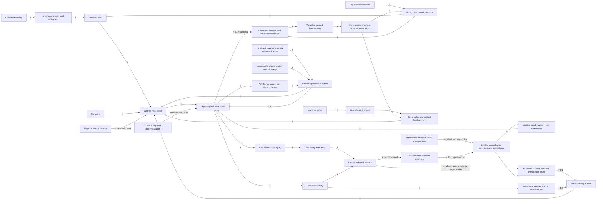

# Heat risk for outdoor workers in Delhi: systems map

**Scope:** DTU/Rohini pilot area, Delhi. This is a qualitative causal model for
discussion and product design, not a Delhi-calibrated causal estimate, a
medical diagnosis, or a substitute for an occupational heat-safety programme.
The social and income feedbacks below are plausible mechanisms to test with
workers and city partners; they should not be read as claims that every worker
has the same conditions. General mechanisms and the limits of the pilot data
are documented in the [source register](./R_systems_sources.md).

## Causal loop diagram

**Loop reading**

- **R1 — Heat, earnings pressure, exposure (reinforcing; conditional):**
  heat strain can reduce work capacity; illness or reduced output can mean
  time away or lower earnings for workers paid by the day or by output. Where
  workers must make up income by working longer or during hotter hours, the
  added exposure increases heat dose. Wage arrangements and worker agency
  determine whether this loop operates.
- **R2 — Urban heat and the workday (reinforcing; conditional):** low tree
  cover and impervious urban surfaces contribute to local heat exposure.
  Greater exposure can slow work; if the same output then requires more time,
  longer exposure feeds back into heat strain. This productivity/time pathway
  is a hypothesis to test locally, not a universal response.
- **R3 — Insecurity and limited protection (reinforcing; hypothesized):**
  insecure work and limited control may make breaks, water, shade, or refusing
  unsafe work harder to access. Lost earnings can increase livelihood
  pressure and further constrain control. The diagram does not imply that
  informality alone causes illness or that every informal worker lacks
  protection.
- **B1 — Worker protection (balancing):** strain or a warning can prompt a
  protective action; feasible shade, water, rest, or schedule changes reduce
  exposure or strain. It balances the exposure-to-strain pathway only when
  the worker can act and the protective resource is actually available.
- **B2 — City learning and investment (balancing):** hotspot evidence can
  help direct funded shade/cooling interventions to exposed places. Effective
  interventions reduce local radiant heat and the risk signal that motivates
  further investment. The map itself does not reduce heat.

The plus/minus marks indicate the direction of a change, holding other
conditions constant; `modifies response` means vulnerability changes the
strain produced by a given exposure rather than acting as heat exposure
itself.

## Root causes, mediators, and symptoms

| Layer | Delhi pilot interpretation | What to verify locally |
|---|---|---|
| Upstream drivers | Anthropogenic climate warming increases the background likelihood and severity of extreme heat [S7](./R_systems_sources.md#s7). Urban form, including limited tree canopy and heat-storing impervious surfaces, shapes neighborhood-scale exposure [S8](./R_systems_sources.md#s8), [S10](./R_systems_sources.md#s10). | Compare observations and forecasts across seasons; map canopy, surface cover, and shaded pedestrian/work locations at a resolution appropriate to the intervention. |
| Structural and institutional causes | Work insecurity, weak bargaining power, and gaps in occupational protections can constrain access to shade, water, rest, schedule changes, and medical response. These are plausible determinants, not a claim about every Delhi worker. | Co-design with workers and employers; document work/pay arrangements, access, enforcement, and who can authorize a break without risking income. |
| Exposure and response mediators | Ambient temperature, humidity, solar/radiant load, physical workload, time in heat, recovery opportunity, hydration, acclimatization, health, and clothing combine to shape heat strain. | Measure or validate site-level conditions and work patterns; do not treat satellite surface temperature or a profile label as a direct measurement of personal physiological state. |
| Symptoms and downstream impacts | Heat cramps, exhaustion, heat stroke and other illness/injury; fatigue and reduced work capacity; missed work and lost earnings where pay or work availability is affected. | Monitor outcomes ethically and with appropriate consent; distinguish measured outcomes from modelled risk and avoid inferring individual illness from a map. |

Root causes are not all directly observable in a weather or satellite feed.
Heat illness, reduced output, and income loss are important outcomes, not
root causes. Heat risk is shaped by both hazard and the ability to avoid,
recover from, and respond to exposure.

## Leverage points and HeatShield's boundary

| Leverage point | Exactly where HeatShield acts | What it cannot fix by itself |
|---|---|---|
| 1. Convert forecast conditions into a useful decision window | The personal-risk flow can translate location/time, weather and planned activity into a risk level, WBGT estimate, factors, and action prompts (the intended `assess_risk` response). | It cannot make forecasts or neighborhood-scale estimates exact, diagnose heat illness, guarantee that a worker receives/understands a message, or make an unsafe job safe. |
| 2. Make protective actions practical | The personal action list can point to available shade, water, rest, or safer work timing; employer/city-facing outputs can show where those resources are absent. | Advice cannot create water, shade, paid breaks, transport, medical care, worker bargaining power, or employer compliance. |
| 3. Target limited city intervention budgets | The hotspot map and optimizer can rank grid cells using heat/risk and exposed-population fields and select candidate locations under a budget. This is a prioritization aid, not a causal estimate of intervention benefit. | It cannot fund, build, maintain, or fairly govern interventions; available population and map layers may omit mobile, informal, or undercounted workers. |
| 4. Improve the evidence loop | Repeated weather, land-surface, street-feature, and intervention records can help partners identify where risk is concentrated and assess whether a chosen action changes measured exposure. | Coarse or mismatched inputs cannot resolve every worksite microclimate; temporal association is not proof of intervention effect. Evaluation needs suitable ground measurements and a comparison design. |
| 5. Put evidence in front of decision-makers | A transparent map and documented assumptions can support municipal planning and occupational-health discussion about shade, water, rest, work schedules, and heat preparedness. | The product cannot change urban land-use decisions, labor law, social protection, wages, climate emissions, or enforcement without institutions and resources acting on the evidence. |

### Current implementation boundary

The repository contains interfaces, not an operational personal risk model or
city optimizer: `build_feature_vector`, `assess_risk`, `predict_risk`,
`calculate_wbgt`, and `optimize_interventions` currently raise
`NotImplementedError`. The six inputs in the table below are the requested
scientific feature concepts, not a claim that all six are already connected
to training or inference. In the current interfaces, humidity is named in
the WBGT function, activity and duration are named in the personal-risk
interfaces, and vulnerability is represented only by an unspecified
`profile`; shade and LST are not explicit personal-model parameters.
The heatmap cell has `temp_c`, `wbgt_c`, risk, and exposed-population fields,
but does not define `temp_c` as satellite LST. Keep LST provenance distinct
from air temperature and WBGT.

## Model input: mechanism and interpretation

| Input | Physical or physiological mechanism | Interpretation and limitation | Sources |
|---|---|---|---|
| Humidity | High relative humidity limits sweat evaporation, reducing a major route of body heat loss; humidity is one component of heat-stress assessment alongside air temperature, wind, and radiation. | Use humidity with temperature and other environmental terms (prefer WBGT or a locally validated equivalent); humidity alone is not a heat-risk score. | [S1](./R_systems_sources.md#s1), [S5](./R_systems_sources.md#s5), [S9](./R_systems_sources.md#s9) |
| Shade | Shade reduces direct short-wave solar exposure and radiant heat load on a person; direct sun can add materially to heat stress even where air temperature is unchanged. | Represent shade at the time and place of work, ideally as a measured or mapped availability/access variable. Canopy presence is not proof that a worker can use the shade. | [S1](./R_systems_sources.md#s1), [S3](./R_systems_sources.md#s3), [S9](./R_systems_sources.md#s9) |
| Land-surface temperature (LST) | Satellite LST is a retrieval of the temperature of the observed land surface. Hot, exposed surfaces indicate stored/radiated urban heat and help locate spatial patterns that may contribute to radiant exposure. | LST is not 2 m air temperature, globe temperature, WBGT, or a worker's body temperature. Landsat LST is daytime, clear-sky and spatially/temporally sampled; combine with weather and local validation rather than treating it as personal dose. | [S4](./R_systems_sources.md#s4), [S5](./R_systems_sources.md#s5) |
| Activity / workload | Muscular work generates metabolic heat; heavier physical work raises internal heat production and occupational heat strain for a given environment. | Use task-specific workload/intensity rather than a broad job title where possible. Clothing/PPE and work-rest patterns also affect strain and must not be silently assumed constant. | [S1](./R_systems_sources.md#s1), [S2](./R_systems_sources.md#s2) |
| Duration | Time spent in heat increases opportunity for body heat storage; breaks in a cooler place enable recovery. Exposure timing and consecutive hot periods can matter as much as a single peak. | Model cumulative exposure and recovery, not just one instant's weather; planned duration may differ from actual hours, and it is not a safe-work threshold by itself. | [S1](./R_systems_sources.md#s1), [S3](./R_systems_sources.md#s3), [S6](./R_systems_sources.md#s6) |
| Vulnerability | Age, pregnancy, prior heat illness, health conditions, some medicines, dehydration and lack of acclimatization can alter an individual's susceptibility or response to a given heat load. | A profile is an imperfect proxy, not a diagnosis. Prefer opt-in, privacy-preserving, locally validated factors; avoid inferring sensitive health states from demographics or using a profile to deny work or services. | [S1](./R_systems_sources.md#s1), [S2](./R_systems_sources.md#s2), [S7](./R_systems_sources.md#s7) |

## Uncertainties and review questions

- Confirm with Delhi outdoor workers whether R1 and R3 reflect local pay,
  scheduling, break access, and control; revise the loop if workers describe
  different feedbacks.
- Confirm whether candidate shade and LST layers can represent a worker's
  route/worksite and time of day. Satellite LST and population rasters have
  different spatial and temporal support from a person moving through a
  neighborhood.
- Validate physiological risk thresholds and action language for Indian
  workers, local climate, task intensity, protective clothing, acclimatization,
  and access to emergency care before operational use.
- A hotspot map shows prioritization evidence, not a guarantee of equal
  coverage. Audit who is counted, who can use an intervention, and who is
  missing from the underlying data.
- This map is ready for team review; it has not yet been reviewed or approved
  by the team.
